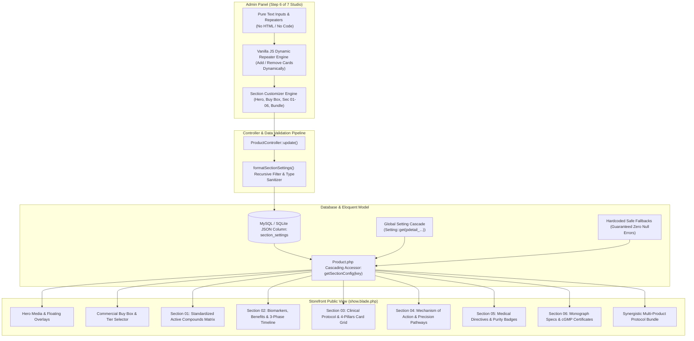

# Enterprise Zero-Code Section Studio & Dynamic Dossier/Monograph Architecture

**Document Version:** 1.0.0  
**Target Ecosystem:** Universal Laravel (10.x / 11.x / 12.x), Blade, Tailwind CSS, Vanilla JS  
**Architecture Classification:** Zero-Code Content Engine, Dynamic Dossier Studio & Controlled Protocol Bundler  
**Status:** Production Standard / Portable Architectural Package Specification

---

## 1. Executive Summary & Zero-Code Philosophy

### 1.1 The Problem It Solves
Traditional CMS and e-commerce platforms force administrators to choose between two undesirable extremes:
1. **Rigid Hardcoding:** Content (such as clinical directives, 4-step protocols, bio-compounds, science mechanisms, and allergen badges) is hardcoded into Blade/HTML templates. Modifying a single word requires a developer, Git commit, and deployment.
2. **Fragile Raw Code Editors:** Administrators are given raw HTML textareas, WYSIWYG editors, or JSON blobs. Non-technical users inevitably break CSS layouts, inject broken tags, ruin dark/light mode responsiveness, or corrupt responsive design tokens on mobile devices.

### 1.2 The "Zero-Code" Architectural Solution
This architecture decouples **pure editorial content** from **high-end presentation logic**:
- **Admin Experience (100% Zero Code):** Administrators edit pure text inputs, textareas, and visual repeaters (cards, timelines, certificates) in English and Arabic. They never see, touch, or write HTML, CSS, or scripts.
- **Storefront Rendering (100% Systematic):** Blade templates control layout, glassmorphic styling, typography tokens, light/dark mode, and mobile responsiveness. The view injects administrator content dynamically, falling back to clinically calibrated defaults if any field is left empty.
- **Universal Portability ("Package Archify"):** The architecture relies solely on native Laravel Eloquent JSON columns, lightweight Blade partials, and vanilla JS repeaters. It requires zero heavy frontend dependencies and can be ported into any system (pharma, luxury retail, SaaS, manufacturing, education) in minutes.

---

## 2. System Architecture & Lifecycle Diagram



---

## 3. Data Layer: The Cascading Fallback Hierarchy

The system enforces a **3-tier cascading resolution hierarchy** for every attribute:

$$\text{Resolved Value} = \text{Product Specific Value} \parallel \text{Global Setting Value} \parallel \text{Hardcoded System Fallback}$$

This guarantees that:
1. A newly created product renders immediately with complete, beautifully styled sections without requiring the user to fill in dozens of fields.
2. An administrator can override any single card, title, or directive on a specific product.
3. Deleting or leaving a field blank instantly restores the master global default rather than breaking the layout.

### 3.1 Database Migration
No new tables or complex schemas are needed. A single nullable JSON column is added to the catalog table:

```php
Schema::table('products', function (Blueprint $table) {
    if (!Schema::hasColumn('products', 'section_settings')) {
        $table->json('section_settings')->nullable()->after('status');
    }
});
```

### 3.2 Eloquent Model Architecture (`Product.php`)

```php
namespace App\Models;

use Illuminate\Database\Eloquent\Model;
use App\Models\Setting;

class Product extends Model
{
    protected $casts = [
        'section_settings' => 'array',
    ];

    /**
     * Universal cascading resolver for public sections.
     */
    public function getSectionConfig(string $key): array
    {
        $productSettings = is_array($this->section_settings) ? ($this->section_settings[$key] ?? []) : [];
        $isRtl = app()->getLocale() === 'ar';

        // Master Default Labels
        $defaultLabels = [
            'dossier' => [
                'badge_en' => 'CLINICAL DOSSIER & BIO-MOLECULAR MONOGRAPH',
                'badge_ar' => 'الملف الطبي والمواصفات السريرية المعتمدة',
                'title_en' => 'Comprehensive Formulation Specifications',
                'title_ar' => 'التفاصيل الدقيقة والخصائص الدوائية للمستحضر',
            ],
            'sec1' => [
                'badge_en' => 'Standardized Monograph',
                'badge_ar' => 'النقاء والجرعات القياسية',
                'title_en' => 'Active Bio-Compounds & Potencies',
                'title_ar' => 'المكونات الفعالة والجرعات المعيارية',
            ],
            'sec2' => [
                'badge_en' => 'Physiological Biomarkers',
                'badge_ar' => 'الأثر الفسيولوجي المباشر والمستدام',
                'title_en' => 'Clinical Benefits & Physiological Targets',
                'title_ar' => 'الفوائد السريرية والمسارات البيولوجية',
            ],
            'sec3' => [
                'badge_en' => 'Synergistic Protocol',
                'badge_ar' => 'الجرعات والتكامل الحيوي',
                'title_en' => 'Clinical Protocol & Usage Guidelines',
                'title_ar' => 'بروتوكول الاستخدام والتوجيهات السريرية',
            ],
            'sec4' => [
                'badge_en' => 'Molecular Pharmacokinetics',
                'badge_ar' => 'الأبحاث الصيدلانية وطول العمر',
                'title_en' => 'Cellular Science & Mechanism of Action',
                'title_ar' => 'الآلية العلمية الدوائية المتقدمة',
            ],
            'sec5' => [
                'badge_en' => 'Clinical Safety & Warnings',
                'badge_ar' => 'الأمان والنزاهة الصيدلانية',
                'title_en' => 'Safety Profile, Warnings & Precautions',
                'title_ar' => 'إرشادات السلامة، التحذيرات وموانع الاستعمال',
            ],
            'sec6' => [
                'badge_en' => 'Batch Certification',
                'badge_ar' => 'بيانات التوثيق والضمان',
                'title_en' => 'Monograph & Supply Specifications',
                'title_ar' => 'المواصفات الفنية، التعبئة وضمان النقاء',
            ],
            'buy_box' => [
                'badge_en' => 'Purchase Information',
                'badge_ar' => 'بيانات الشراء',
                'title_en' => 'Order & Quick Checkout',
                'title_ar' => 'طلب المستحضر والشراء السريع',
            ],
            'related' => [
                'badge_en' => 'SYNERGISTIC LONGEVITY PROTOCOLS',
                'badge_ar' => 'التكامل الحيوي',
                'title_en' => 'Complementary Formulations',
                'title_ar' => 'تركيبات متكاملة تعزز النتائج',
            ],
        ];

        // 1. Viewport Visibility Cascade
        $globalEnabled = (bool) Setting::get("pdetail_{$key}_enabled", true);
        $enabledDesktop = array_key_exists('enabled_desktop', $productSettings) ? (bool)$productSettings['enabled_desktop'] : $globalEnabled;
        $enabledMobile  = array_key_exists('enabled_mobile', $productSettings)  ? (bool)$productSettings['enabled_mobile']  : $globalEnabled;
        $defaultOpen    = array_key_exists('default_open', $productSettings)    ? (bool)$productSettings['default_open']    : ($key === 'sec1');

        $isVisible = $globalEnabled && ($enabledDesktop || $enabledMobile);
        $responsiveClass = '';
        if (!$enabledDesktop && !$enabledMobile) {
            $responsiveClass = 'hidden';
            $isVisible = false;
        } elseif ($enabledDesktop && !$enabledMobile) {
            $responsiveClass = 'hidden md:block';
        } elseif (!$enabledDesktop && $enabledMobile) {
            $responsiveClass = 'block md:hidden';
        }

        // 2. Bilingual Title & Badge Cascade
        $badgeEn = !empty($productSettings['badge_en']) ? $productSettings['badge_en'] : Setting::get("pdetail_{$key}_badge_en", $defaultLabels[$key]['badge_en'] ?? '');
        $badgeAr = !empty($productSettings['badge_ar']) ? $productSettings['badge_ar'] : Setting::get("pdetail_{$key}_badge_ar", $defaultLabels[$key]['badge_ar'] ?? '');
        $titleEn = !empty($productSettings['title_en']) ? $productSettings['title_en'] : Setting::get("pdetail_{$key}_title_en", $defaultLabels[$key]['title_en'] ?? '');
        $titleAr = !empty($productSettings['title_ar']) ? $productSettings['title_ar'] : Setting::get("pdetail_{$key}_title_ar", $defaultLabels[$key]['title_ar'] ?? '');

        return [
            'enabled_desktop' => $enabledDesktop,
            'enabled_mobile'  => $enabledMobile,
            'is_visible'      => $isVisible,
            'responsive_class'=> $responsiveClass,
            'default_open'    => $defaultOpen,
            'badge'           => $isRtl && !empty($badgeAr) ? $badgeAr : ($badgeEn ?: $badgeAr),
            'title'           => $isRtl && !empty($titleAr) ? $titleAr : ($titleEn ?: $titleAr),
            'items'           => $productSettings['items'] ?? [],
            'certificates'    => $productSettings['certificates'] ?? [],
            'benefits'        => $productSettings['benefits'] ?? [],
            'phases'          => $productSettings['phases'] ?? [],
            'dose_badge'      => $isRtl ? ($productSettings['dose_badge_ar'] ?? $productSettings['dose_badge_en'] ?? '') : ($productSettings['dose_badge_en'] ?? $productSettings['dose_badge_ar'] ?? ''),
            'primary_directive'=> $isRtl ? ($productSettings['primary_directive_ar'] ?? $productSettings['primary_directive_en'] ?? '') : ($productSettings['primary_directive_en'] ?? $productSettings['primary_directive_ar'] ?? ''),
            'cards'           => $productSettings['cards'] ?? [],
            'mechanism'       => $isRtl ? ($productSettings['mechanism_ar'] ?? $productSettings['mechanism_en'] ?? '') : ($productSettings['mechanism_en'] ?? $productSettings['mechanism_ar'] ?? ''),
            'pathways'        => $productSettings['pathways'] ?? [],
            'research_note'   => $isRtl ? ($productSettings['research_note_ar'] ?? $productSettings['research_note_en'] ?? '') : ($productSettings['research_note_en'] ?? $productSettings['research_note_ar'] ?? ''),
            'warnings'        => $isRtl ? ($productSettings['warnings_ar'] ?? $productSettings['warnings_en'] ?? '') : ($productSettings['warnings_en'] ?? $productSettings['warnings_ar'] ?? ''),
            'contraindications'=> $isRtl ? ($productSettings['contraindications_ar'] ?? $productSettings['contraindications_en'] ?? '') : ($productSettings['contraindications_en'] ?? $productSettings['contraindications_ar'] ?? ''),
            'purity_badges'   => $productSettings['purity_badges'] ?? [],
            'specs'           => $productSettings['specs'] ?? [],
            'bundle'          => ($key === 'related') ? ($productSettings['bundle'] ?? null) : null,
        ];
    }
}
```

---

## 4. Controller Pipeline: Recursive Filter & Type Sanitizer

The controller receives raw form inputs from the admin customizer and recursively sanitizes them:
1. Strips any unintended HTML tags to guarantee security.
2. Filters out empty array elements (e.g. empty card rows).
3. Validates and casts boolean switches, percentage discounts, and integer values.

### 4.1 Controller Implementation (`ProductController.php`)

```php
protected function formatSectionSettings(array &$data, Request $request): void
{
    if (!$request->has('section_settings') && !isset($data['section_settings'])) {
        return;
    }

    $raw = $request->input('section_settings', $data['section_settings'] ?? []);
    $clean = [];
    $allKeys = ['dossier', 'sec1', 'sec2', 'sec3', 'sec4', 'sec5', 'sec6', 'buy_box', 'related'];

    foreach ($allKeys as $key) {
        $sec = is_array($raw) ? ($raw[$key] ?? []) : [];
        $clean[$key] = [
            'enabled_desktop' => !empty($sec['enabled_desktop']),
            'enabled_mobile'  => !empty($sec['enabled_mobile']),
            'default_open'    => !empty($sec['default_open']),
            'title_en'        => trim($sec['title_en'] ?? ''),
            'title_ar'        => trim($sec['title_ar'] ?? ''),
            'badge_en'        => trim($sec['badge_en'] ?? ''),
            'badge_ar'        => trim($sec['badge_ar'] ?? ''),
        ];

        // Section 1: Active Compounds Matrix
        if ($key === 'sec1' && isset($sec['items']) && is_array($sec['items'])) {
            $clean[$key]['items'] = array_values(array_filter($sec['items'], fn($i) => is_array($i) && !empty(array_filter($i))));
        }

        // Section 2: Benefits List & 3-Phase Biological Timeline
        if ($key === 'sec2') {
            if (isset($sec['benefits']) && is_array($sec['benefits'])) {
                $clean[$key]['benefits'] = array_values(array_filter($sec['benefits'], function($b) {
                    return is_array($b) ? (!empty($b['text_en']) || !empty($b['text_ar'])) : !empty(trim($b));
                }));
            }
            if (isset($sec['phases']) && is_array($sec['phases'])) {
                $clean[$key]['phases'] = array_values(array_filter($sec['phases'], fn($p) => is_array($p) && (!empty($p['title_en']) || !empty($p['title_ar']))));
            }
        }

        // Section 3: Protocol Dosage, Primary Directive, and 4 Visual Cards
        if ($key === 'sec3') {
            $clean[$key]['dose_badge_en'] = trim($sec['dose_badge_en'] ?? '');
            $clean[$key]['dose_badge_ar'] = trim($sec['dose_badge_ar'] ?? '');
            $clean[$key]['primary_directive_en'] = trim($sec['primary_directive_en'] ?? '');
            $clean[$key]['primary_directive_ar'] = trim($sec['primary_directive_ar'] ?? '');
            if (isset($sec['cards']) && is_array($sec['cards'])) {
                $clean[$key]['cards'] = array_values(array_filter($sec['cards'], fn($c) => is_array($c) && (!empty($c['title_en']) || !empty($c['title_ar']))));
            }
        }

        // Section 4: Science Mechanism, Precision Pathways, and Research Citation
        if ($key === 'sec4') {
            $clean[$key]['mechanism_en'] = trim($sec['mechanism_en'] ?? '');
            $clean[$key]['mechanism_ar'] = trim($sec['mechanism_ar'] ?? '');
            $clean[$key]['research_note_en'] = trim($sec['research_note_en'] ?? '');
            $clean[$key]['research_note_ar'] = trim($sec['research_note_ar'] ?? '');
            if (isset($sec['pathways']) && is_array($sec['pathways'])) {
                $clean[$key]['pathways'] = array_values(array_filter($sec['pathways'], fn($p) => is_array($p) && (!empty($p['title_en']) || !empty($p['title_ar']))));
            }
        }

        // Section 5: Warnings, Contraindications, and 4 Purity Badges
        if ($key === 'sec5') {
            $clean[$key]['warnings_en'] = trim($sec['warnings_en'] ?? '');
            $clean[$key]['warnings_ar'] = trim($sec['warnings_ar'] ?? '');
            $clean[$key]['contraindications_en'] = trim($sec['contraindications_en'] ?? '');
            $clean[$key]['contraindications_ar'] = trim($sec['contraindications_ar'] ?? '');
            if (isset($sec['purity_badges']) && is_array($sec['purity_badges'])) {
                $clean[$key]['purity_badges'] = array_values(array_filter($sec['purity_badges'], fn($b) => is_array($b) && (!empty($b['text_en']) || !empty($b['text_ar']))));
            }
        }

        // Section 6: Monograph Certificates & Technical Specs
        if ($key === 'sec6') {
            if (isset($sec['certificates']) && is_array($sec['certificates'])) {
                $clean[$key]['certificates'] = array_values(array_filter($sec['certificates'], fn($c) => is_array($c) && (!empty($c['name_en']) || !empty($c['name_ar']))));
            }
            if (isset($sec['specs']) && is_array($sec['specs'])) {
                $clean[$key]['specs'] = $sec['specs'];
            }
        }

        // Commercial Buy Box
        if ($key === 'buy_box') {
            $clean[$key]['stock_status_en'] = trim($sec['stock_status_en'] ?? '');
            $clean[$key]['stock_status_ar'] = trim($sec['stock_status_ar'] ?? '');
            $clean[$key]['save_badge_en']   = trim($sec['save_badge_en'] ?? '');
            $clean[$key]['save_badge_ar']   = trim($sec['save_badge_ar'] ?? '');
            $clean[$key]['btn_add_cart_en'] = trim($sec['btn_add_cart_en'] ?? '');
            $clean[$key]['btn_add_cart_ar'] = trim($sec['btn_add_cart_ar'] ?? '');
            $clean[$key]['guarantee_days']  = max(0, (int)($sec['guarantee_days'] ?? 30));
        }

        // Related Synergistic Protocol Bundle
        if ($key === 'related' && isset($sec['bundle'])) {
            $b = $sec['bundle'];
            $clean[$key]['bundle'] = [
                'enabled'        => !empty($b['enabled']),
                'discount_type'  => in_array($b['discount_type'] ?? 'percentage', ['percentage', 'fixed']) ? $b['discount_type'] : 'percentage',
                'discount_value' => (float)($b['discount_value'] ?? 15.0),
                'badge_en'       => trim($b['badge_en'] ?? 'Optimal Synergistic Protocol'),
                'badge_ar'       => trim($b['badge_ar'] ?? 'البروتوكول التكاملي الموصى به'),
                'product_ids'    => array_values(array_filter(array_map('intval', (array)($b['product_ids'] ?? [])))),
            ];
        }
    }

    $data['section_settings'] = $clean;
}
```

---

## 5. Admin Customizer Studio Architecture

The Admin Studio is organized into high-contrast, modular Blade sub-partials inside `resources/views/admin/products/partials/customizer/`:

```
resources/views/admin/products/partials/
├── section_customizer_step.blade.php      # Master Studio Wizard Container
└── customizer/
    ├── hero_overlays.blade.php            # Watermark & Floating Badges
    ├── protocol_durations.blade.php       # Duration Pricing Tiers (30/60/90 Days)
    ├── buy_box.blade.php                  # Stock Status, Guarantee & CTA Buttons
    ├── sec1_ingredients.blade.php        # Active Bio-Compounds Matrix
    ├── sec2_biomarkers.blade.php         # Biomarkers, Benefits & 3-Phase Timeline
    ├── sec3_protocol.blade.php           # Primary Directive & 4-Pillars Card Grid
    ├── sec4_mechanism.blade.php          # Mechanism & Precision Pathways
    ├── sec5_warnings.blade.php           # Medical Advisory & Purity Badges
    ├── sec6_certifications.blade.php     # Technical Specs & cGMP Certificates
    └── custom_blocks.blade.php           # Modular FAQ & Custom Feature Blocks
```

### 5.1 Card Structure Pattern
Every sub-partial follows an identical, senior-grade pattern:
- **Badge & Title:** Clear icon, bilingual label, and high-contrast typography.
- **Form Fields:** Structured `<input>` and `<textarea>` with `dir="rtl"` for Arabic and `font-mono` for codes/potencies.
- **Client-Side Add / Remove Buttons:** Pure vanilla JS event handlers that clone template rows or append dynamic DOM nodes with auto-incremented array indices `[0]`, `[1]`, `[2]`.

### 5.2 Dynamic Repeaters (Vanilla JS Engine)
Example of a clean client-side repeater that requires zero external libraries:

```javascript
function addProtocolCardRow() {
    const container = document.getElementById('sec3CardsList');
    if (!container) return;
    const nextIdx = container.querySelectorAll('.protocol-card-row').length + Math.floor(Math.random() * 1000);
    const div = document.createElement('div');
    div.className = 'p-4 rounded-xl bg-slate-50 dark:bg-[#062B49] border border-slate-200 dark:border-slate-700 space-y-3 protocol-card-row';
    div.dataset.index = nextIdx;
    div.innerHTML = `
        <div class="flex items-center justify-between">
            <span class="px-2 py-0.5 rounded-md bg-sky-500/15 text-sky-600 font-mono text-[10px] font-black">
                CARD #${nextIdx + 1}
            </span>
            <button type="button" onclick="this.closest('.protocol-card-row').remove()" class="w-7 h-7 rounded-lg bg-rose-500/10 hover:bg-rose-500/20 text-rose-600 flex items-center justify-center transition-colors cursor-pointer">
                <i class="fa-solid fa-trash-can text-xs"></i>
            </button>
        </div>
        <div class="grid grid-cols-1 sm:grid-cols-12 gap-3">
            <div class="sm:col-span-2">
                <label class="block text-[10px] font-bold text-slate-500 mb-0.5">Icon (FA):</label>
                <input type="text" name="section_settings[sec3][cards][${nextIdx}][icon]" value="fa-clock" class="w-full px-2.5 py-1.5 text-xs rounded-lg border border-slate-300 dark:border-slate-600 dark:bg-[#031827] dark:text-white font-mono">
            </div>
            <div class="sm:col-span-5">
                <label class="block text-[10px] font-bold text-slate-500 mb-0.5">Title (EN):</label>
                <input type="text" name="section_settings[sec3][cards][${nextIdx}][title_en]" value="" placeholder="Protocol Pillar" class="w-full px-2.5 py-1.5 text-xs rounded-lg border border-slate-300 dark:border-slate-600 dark:bg-[#031827] dark:text-white font-bold">
            </div>
            <div class="sm:col-span-5">
                <label class="block text-[10px] font-bold text-slate-500 mb-0.5">العنوان (AR):</label>
                <input type="text" name="section_settings[sec3][cards][${nextIdx}][title_ar]" value="" dir="rtl" placeholder="عنوان الركيزة" class="w-full px-2.5 py-1.5 text-xs rounded-lg border border-slate-300 dark:border-slate-600 dark:bg-[#031827] dark:text-white font-tajawal font-bold">
            </div>
        </div>
        <div class="grid grid-cols-1 sm:grid-cols-2 gap-3">
            <div>
                <label class="block text-[10px] font-bold text-slate-500 mb-0.5">Description (EN):</label>
                <textarea name="section_settings[sec3][cards][${nextIdx}][description_en]" rows="2" placeholder="Clinical instruction..." class="w-full p-2 text-xs rounded-lg border border-slate-300 dark:border-slate-600 dark:bg-[#031827] dark:text-white"></textarea>
            </div>
            <div>
                <label class="block text-[10px] font-bold text-slate-500 mb-0.5">الوصف (AR):</label>
                <textarea name="section_settings[sec3][cards][${nextIdx}][description_ar]" rows="2" dir="rtl" placeholder="التوجيه السريري..." class="w-full p-2 text-xs rounded-lg border border-slate-300 dark:border-slate-600 dark:bg-[#031827] dark:text-white font-tajawal"></textarea>
            </div>
        </div>
    `;
    container.appendChild(div);
}
```

---

## 6. Storefront Dynamic Rendering Engine (`show.blade.php`)

On the public storefront, the view template executes clean loops over the resolved model arrays with automatic default fallbacks:

### 6.1 Section 03 Example: Protocol Directive & 4-Pillars Card Grid

```blade
@if($sec3['is_visible'])
<div id="accordion-usage" class="bz-collapsible-item {{ $sec3['default_open'] ? 'is-open' : '' }} {{ $sec3['responsive_class'] }} rounded-3xl bg-white dark:bg-[#062B49] border border-[#0A4F78]/20 transition-all duration-300 overflow-hidden">
  <!-- Header with Live Chevron & Dosage Badge -->
  <button type="button" onclick="toggleProductDetailItem('accordion-usage')" class="w-full p-5 sm:p-7 flex justify-between items-center text-left rtl:text-right cursor-pointer select-none group">
    <div class="flex items-center gap-4">
      <div class="w-12 h-12 rounded-2xl bg-[#2A8FC2]/15 text-[#2A8FC2] flex items-center justify-center text-xl shrink-0 group-hover:scale-105 transition-transform">
        <i class="fa-solid fa-calendar-check"></i>
      </div>
      <div>
        <div class="flex items-center gap-2 flex-wrap mb-1">
          <span class="text-[10px] font-mono uppercase px-2 py-0.5 rounded bg-[#2A8FC2]/15 text-[#2A8FC2] font-extrabold">SECTION 03</span>
          <span class="text-[11px] font-bold text-[#031827]/60 dark:text-[#F6F5EF]/60 uppercase tracking-widest">{{ $sec3['badge'] }}</span>
        </div>
        <h3 class="text-lg sm:text-xl font-black text-[#031827] dark:text-[#F6F5EF]">
          {{ $sec3['title'] }}
        </h3>
      </div>
    </div>

    <div class="flex items-center gap-3">
      <span class="hidden sm:inline-block px-3 py-1 rounded-full bg-[#2A8FC2]/10 text-[#2A8FC2] text-xs font-bold font-mono">
        {{ $sec3['dose_badge'] ?: $dosageText }}
      </span>
      <span class="bz-chevron-icon w-8 h-8 rounded-full bg-[#0A4F78]/5 dark:bg-white/5 flex items-center justify-center text-sm text-[#0A4F78] dark:text-[#2A8FC2]">
        <i class="fa-solid fa-chevron-down"></i>
      </span>
    </div>
  </button>

  <!-- Collapsible Content Grid -->
  <div class="bz-collapsible-grid">
    <div class="bz-collapsible-inner p-5 sm:p-8 pt-0 border-t border-[#0A4F78]/10 dark:border-[#0A4F78]/20 space-y-6">
      
      <!-- Primary Directive Callout Box -->
      <div class="p-4 sm:p-6 rounded-2xl bg-[#0A4F78]/5 dark:bg-[#031827] border-inline-start-4 border-[#2A8FC2] space-y-2">
        <span class="text-xs font-extrabold uppercase tracking-wider text-[#0A4F78] dark:text-[#2A8FC2] block">
          <i class="fa-solid fa-circle-info mr-1 ml-1"></i> {{ $isRtl ? 'الإرشاد السريري المباشر:' : 'Primary Administration Directive:' }}
        </span>
        <p class="text-xs sm:text-sm text-[#031827] dark:text-[#F6F5EF] font-medium leading-relaxed">
          {{ $sec3['primary_directive'] ?: $usageText }}
        </p>
      </div>

      <!-- 4 Visual Protocol Cards Grid -->
      @php
        $activeProtocolCards = !empty($sec3['cards']) && is_array($sec3['cards']) ? $sec3['cards'] : [
          ['icon' => 'fa-sun', 'title_en' => '1. Timing', 'title_ar' => '1. التوقيت اليومي', 'description_en' => 'Administer each morning to harmonize with your natural circadian cortisol curve.', 'description_ar' => 'يُفضل تناوله صباحاً ليتزامن مع إيقاع الساعة البيولوجية للجسم.'],
          ['icon' => 'fa-glass-water', 'title_en' => '2. Hydration', 'title_ar' => '2. السائل الناقل', 'description_en' => '250ml mineralized water facilitates rapid gastro-resistant dissolution.', 'description_ar' => '250 مل من الماء النقي لتسريع ذوبان الكبسولة المعوية النباتية.'],
          ['icon' => 'fa-bottle-droplet', 'title_en' => '3. Lipid Synergy', 'title_ar' => '3. تعزيز الامتصاص', 'description_en' => 'Ingesting with healthy fats boosts lipophilic flavonoid bioavailability by up to 300%.', 'description_ar' => 'تناوله مع زيت الزيتون البكر الممتاز يضاعف امتصاص مضادات الأكسدة.'],
          ['icon' => 'fa-repeat', 'title_en' => '4. Regularity', 'title_ar' => '4. الاستمرارية', 'description_en' => 'Zero tolerance buildup or dependency. Engineered for uninterrupted daily longevity.', 'description_ar' => 'لا يسبب الإدمان أو الاعتمادية، ومصمم للاستخدام اليومي المستمر بأمان.'],
        ];
        $cardColorThemes = [
          0 => ['bg' => 'bg-[#67B34A]/15', 'text' => 'text-[#67B34A]'],
          1 => ['bg' => 'bg-[#2A8FC2]/15', 'text' => 'text-[#2A8FC2]'],
          2 => ['bg' => 'bg-amber-500/15', 'text' => 'text-amber-500'],
          3 => ['bg' => 'bg-purple-500/15', 'text' => 'text-purple-500'],
        ];
      @endphp
      <div class="grid grid-cols-1 sm:grid-cols-2 lg:grid-cols-4 gap-4">
        @foreach($activeProtocolCards as $cIdx => $card)
          @php
            $cIcon = $card['icon'] ?? 'fa-circle-check';
            $cTitle = $isRtl ? ($card['title_ar'] ?? $card['title_en'] ?? '') : ($card['title_en'] ?? $card['title_ar'] ?? '');
            $cDesc = $isRtl ? ($card['description_ar'] ?? $card['description_en'] ?? '') : ($card['description_en'] ?? $card['description_ar'] ?? '');
            $cColors = $cardColorThemes[$cIdx % 4];
          @endphp
          <div class="p-4 rounded-2xl bg-[#F6F5EF] dark:bg-[#031827] border border-[#0A4F78]/15 space-y-2 text-center">
            <div class="w-10 h-10 rounded-full {{ $cColors['bg'] }} {{ $cColors['text'] }} mx-auto flex items-center justify-center text-base">
              <i class="fa-solid {{ $cIcon }}"></i>
            </div>
            <h4 class="text-xs font-bold text-[#031827] dark:text-white">{{ $cTitle }}</h4>
            <p class="text-[11px] text-[#031827]/70 dark:text-[#F6F5EF]/70 leading-relaxed">
              {{ $cDesc }}
            </p>
          </div>
        @endforeach
      </div>

    </div>
  </div>
</div>
@endif
```

---

## 7. Synergistic Multi-Product Bundle & Cart Engine

The system features a **controlled multi-product protocol bundler** built into the product page:
1. When configuring a product, the admin can select 1 or more complementary products to bundle with it.
2. The admin sets a controlled discount (e.g., `15%` or fixed `50 EGP`).
3. On the storefront, customers can click a single button ("ADD COMPLETE PROTOCOL BUNDLE") which atomically adds the parent product and all bundled products into the cart session with the discount attached as an item metadata tag.
4. The `CartService` applies the discount automatically in the cart and checkout stages.

---

## 8. Package Archival Specification (Packaging into Reusable Library)

To convert this architecture into an independent Composer package (`vendor/package-name`):

```
packages/vendor/laravel-section-studio/
├── composer.json
├── config/
│   └── section-studio.php                 # Section definitions, default labels & icons
├── database/
│   └── migrations/
│       └── add_section_settings_to_table.php.stub
├── resources/
│   └── views/
│       ├── admin/
│       │   ├── master.blade.php
│       │   └── partials/*.blade.php
│       └── storefront/
│           └── sections/*.blade.php
├── src/
│   ├── SectionStudioServiceProvider.php
│   ├── Traits/
│   │   └── HasSectionStudio.php           # Trait attached to Product or any Eloquent model
│   └── Http/
│       └── Middleware/
└── README.md
```

### The `HasSectionStudio` Trait
Any Eloquent model (`Product`, `Course`, `Service`, `Property`) can use the trait:
```php
use Vendor\SectionStudio\Traits\HasSectionStudio;

class Product extends Model
{
    use HasSectionStudio;
}
```

---

## 9. THE UNIVERSAL MASTER IMPLEMENTATION PROMPT

The following prompt is a battle-tested, complete instruction set that you can give to an AI coding agent (Claude, ChatGPT, Antigravity, Gemini CLI) to implement this complete architecture in **any** Laravel application:

````markdown
# MASTER PROMPT: IMPLEMENT ZERO-CODE SECTION STUDIO & DYNAMIC DOSSIER ENGINE

You are acting as Senior Software Architect, Senior Full-Stack Engineer, and UI/UX Designer.
Your objective is to implement the **Zero-Code Section Studio & Dynamic Dossier/Monograph Engine** in this repository.

### MANDATORY CORE REQUIREMENTS & CONSTRAINTS:
1. **ZERO-CODE PHILOSOPHY (STRICT):**
   - The admin panel must NEVER require or present raw HTML textareas, WYSIWYG editors, or code snippets to the user.
   - All section customizations (badges, titles, active compounds, 3-phase biological timelines, 4-step protocols, precision pathways, purity badges, and monograph specs) must be structured into **pure bilingual form inputs, textareas, and vanilla JS repeaters**.
   - The storefront Blade templates own 100% of the HTML markup, glassmorphic styles, Tailwind CSS classes, and light/dark mode styling.

2. **DATABASE & ELOQUENT DATA LAYER:**
   - Add a nullable JSON column `section_settings` to the target catalog model (e.g. `products`).
   - Implement the `getSectionConfig(string $key): array` method on the model with a 3-tier cascade:
     Product-level value -> Global setting value (`Setting::get(...)`) -> Hardcoded safe system fallback.
   - Implement helper methods: `getHeroOverlaysConfig()`, `getBuyBoxConfig()`, `getProtocolDurationsConfig()`, `getCustomBlocksConfig()`.

3. **CONTROLLER VALIDATION & SANITIZATION:**
   - In the administrative update controller (e.g. `ProductController::update`), add `formatSectionSettings(array &$data, Request $request)`.
   - Recursively sanitize all inputs, strip dangerous tags, and filter empty repeater array items so database records stay clean and compact.

4. **ADMIN STUDIO PARTIALS STRUCTURE:**
   - Create modular sub-partials under `resources/views/admin/{module}/partials/customizer/`:
     - `hero_overlays.blade.php`: Watermarks and floating pill/dot badges.
     - `protocol_durations.blade.php`: Duration pricing tiers (e.g. 30/60/90 days).
     - `buy_box.blade.php`: Stock status, save badges, CTA button overrides, guarantee days.
     - `sec1_ingredients.blade.php`: Active compounds repeater (Compound, Potency, Purity, Role).
     - `sec2_biomarkers.blade.php`: Clinical outcomes repeater and 3-Phase Timeline cards (Phase 1, 2, 3).
     - `sec3_protocol.blade.php`: Dosage badge, primary directive, and the 4 Visual Protocol Cards (Timing, Hydration, Lipid Synergy, Regularity).
     - `sec4_mechanism.blade.php`: Mechanism of action, Precision Pathways repeater, and Research Note callout.
     - `sec5_warnings.blade.php`: Medical advisory, contraindications, and 4 Purity & Allergen badges (Gluten-Free, Soy-Free, Vegan, No Preservatives).
     - `sec6_certifications.blade.php`: cGMP/ISO certificates repeater and Technical Specifications grid (Supply volume, delivery matrix, facility standards, shelf life).
     - `custom_blocks.blade.php`: Modular FAQ and features grid blocks.
   - Master Studio Wizard: Include viewport switches (Desktop vs Mobile), accordion state toggle (Open by default), and bilingual tabs (EN / AR).

5. **STOREFRONT DYNAMIC ACCORDION & RENDER ENGINE:**
   - In the public show view (e.g. `show.blade.php`), wire all accordions to read dynamically from `$product->getSectionConfig($key)`.
   - Implement graceful fallbacks: if an administrator leaves any section, card, or badge empty, the system must seamlessly render the default verified domain cards without breaking.

6. **VERIFICATION:**
   - Run linter checks (`php -l`) on every created or modified file.
   - Clear views cache (`php artisan view:clear`).
   - Test storefront HTTP response (`HTTP 200 OK`).

Execute the implementation cleanly with zero leftover code snippets or debug dumps.
````

---

## 10. Operational Checklist for Production Deployment

Before tagging a release or deploying this architecture:
- [x] Database migration executed or verified (`section_settings` JSON column).
- [x] Eloquent model cast registered (`'section_settings' => 'array'`).
- [x] Linter check passed for all sub-partials (`php -l resources/views/admin/products/partials/customizer/*.blade.php`).
- [x] Viewport visibility verified: Desktop-only (`hidden md:block`), Mobile-only (`block md:hidden`), and Both (`block`).
- [x] RTL / Arabic typography verified with proper Tajawal font rendering and `dir="rtl"`.
- [x] Dark mode tokens verified (`#031827`, `#062B49`, `#0A4F78`, `#2A8FC2`, `#67B34A`).
- [x] Storefront response verified with `HTTP 200 OK`.
