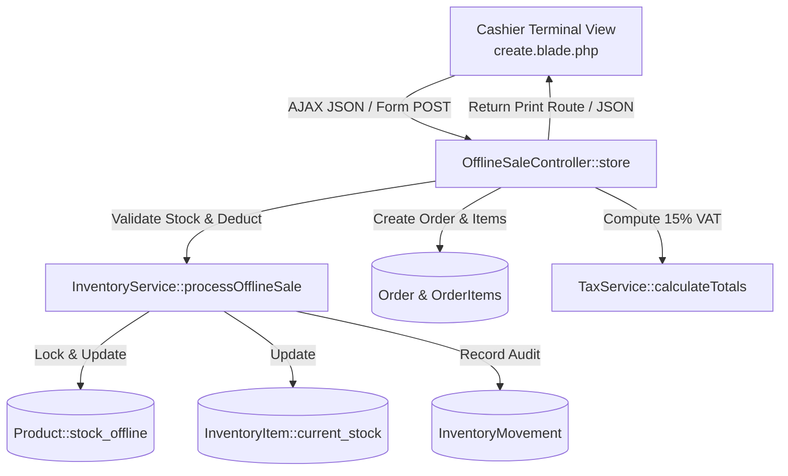
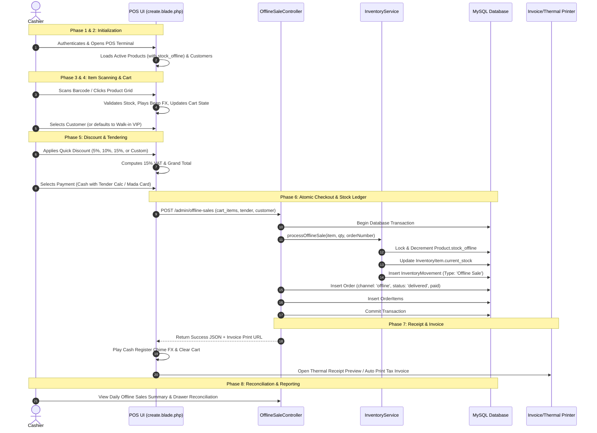

# BLUE ZONE™ — POS System Architecture: Module Integration, Logic & Lifecycle

**Document Version:** 1.0.0  
**Target System:** BLUE ZONE™ Cellular Longevity & Wellness Platform  
**Environment:** Laravel 11/12 (PHP 8.3), MySQL/SQLite, Blade, Vanilla JS & Design Tokens  

---

## 1. Executive Summary

In the **BLUE ZONE™** ecosystem, the **Point of Sale (POS) / Offline Sales** engine represents the physical flagship counter and warehouse direct-sale terminal. Unlike standard e-commerce orders that go through cart queues and asynchronous delivery logistics, the POS module demands **real-time stock validation, sub-millisecond barcode lookups, atomic database transactions, instant physical receipt printing (thermal & tax invoice), and segregated channel inventory management**.

This document provides a comprehensive audit of **every module across the application that touches or utilizes POS**, followed by an in-depth breakdown of the **POS architectural logic** and the complete **end-to-end POS operational cycle**.

---

## 2. Comprehensive Matrix of Modules Interacting with POS

The POS system does not operate in isolation; it integrates into **10 core application modules**:

| # | Module Name | Primary Files & Classes | Interaction with POS | Permissions / Keys |
|---|---|---|---|---|
| **1** | **POS / Offline Sales (Core)** | • `OfflineSaleController.php`<br>• `resources/views/admin/offline-sales/create.blade.php`<br>• `resources/views/admin/offline-sales/index.blade.php`<br>• `resources/views/admin/offline-sales/show.blade.php`<br>• `routes/admin.php` | • Central cashier checkout interface.<br>• Touch-screen product grid, barcode scanner listener.<br>• Multi-item cart manager, draft hold/resume.<br>• Cash tender calculator, card terminal gateway selection. | `offline_sales.view`<br>`offline_sales.create`<br>`offline_sales.edit`<br>`offline_sales.delete`<br>`manage_offline_sales` |
| **2** | **Inventory & Stock Management** | • `InventoryService.php`<br>• `InventoryController.php`<br>• `InventoryItem.php`<br>• `InventoryMovement.php`<br>• `Location.php`<br>• `WarehouseController.php` | • Dedicated warehouse location (`LOC-POS`, `Warehouse / POS`).<br>• Segregated stock pool (`stock_offline`).<br>• Atomic deduction via `InventoryService::processOfflineSale()`.<br>• Generates permanent audit trail in `InventoryMovement`.<br>• Stock replenishment via warehouse transfers & batch splitting. | `inventory.view`<br>`inventory.edit`<br>`warehouses.view` |
| **3** | **Product Catalog & Packaging** | • `Product.php`<br>• `ProductController.php`<br>• `Category.php`<br>• `ProductViewModel.php` | • Supplies product metadata (SKU, barcode, name EN/AR, price, image).<br>• Supplies real-time `stock_offline` balances.<br>• Variant definitions (e.g. Standard 60 Caps, Professional Pack). | `products.view`<br>`products.edit` |
| **4** | **Order Management & Fulfillment** | • `Order.php`<br>• `OrderItem.php`<br>• `OrderController.php`<br>• `OrderViewModel.php` | • Ingests POS sales as `Order` with `channel = 'offline'`.<br>• Immediate status setting: `status = 'delivered'`, `payment_status = 'paid'`.<br>• Unique numbering formats: `POS-YYYYMMDD-XXX` and `INV-POS-YYYYMMDD-XXX`. | `orders.view`<br>`orders.create` |
| **5** | **Invoicing & ZATCA Printing** | • `InvoiceController.php`<br>• `resources/views/admin/invoices/print.blade.php`<br>• Thermal modal inside `create.blade.php` | • Produces official corporate tax invoices (`/admin/invoices/{id}/print`).<br>• Real-time 80mm thermal receipt generator with simulated ZATCA QR code.<br>• Avery barcode/shipping label printing (`/admin/invoices/{id}/label`). | `invoices.view` |
| **6** | **Customer Relationship Management (CRM)** | • `Customer.php`<br>• `CustomerController.php`<br>• `CrmCustomerService.php` | • Customer quick-search dropdown during POS transaction.<br>• Links walk-in transactions to customer profile for Lifetime Value (LTV).<br>• Graceful default fallback for unregistered walk-in buyers. | `customers.view`<br>`customers.create` |
| **7** | **Taxation & Financial Currency** | • `TaxService.php`<br>• `CurrencyService.php`<br>• `PaymentWebhookController.php` | • Computes 15% Saudi VAT on taxable subtotal post-discount.<br>• Formats dynamic localized currency (`SAR` / `ر.س`).<br>• Tracks payment methods: Cash, Mada / Debit POS Terminal, Credit Card. | System Core |
| **8** | **Analytics, BI & Reporting** | • `ReportController.php`<br>• `ReportViewModel.php`<br>• `SupplyChainReportController.php` | • Segregates physical POS revenue from online e-commerce.<br>• Analyzes POS turnover, cashier productivity, average ticket value, and payment method distribution. | `reports.view` |
| **9** | **Role-Based Access Control (RBAC)** | • `User.php`<br>• `Role.php`<br>• `RoleController.php`<br>• `RoleViewModel.php`<br>• `UserViewModel.php` | • Enforces POS permissions.<br>• Dedicated role: `Sales User (POS / Retail)` / `أخصائي المبيعات ونقاط البيع`.<br>• Stamps cashier identity onto orders and stock movements. | `users.view`<br>`roles.edit` |
| **10** | **Supply Chain & Production (Upstream)** | • `GoodsReceiptController.php`<br>• `WorkOrderController.php`<br>• `PurchaseOrderController.php` | • Received inventory from production or purchase orders is distributed to `stock_central` and replenished to `stock_offline`. | `inventory.view`<br>`supply_chain.view` |

---

## 3. Deep Architectural Logic of the POS

### 3.1 Design Patterns & Architecture Overview
1. **Service Layer Pattern**: All stock deductions and audit movements are encapsulated in `App\Services\InventoryService`, keeping `OfflineSaleController` thin and decoupled.
2. **Database Transaction Pattern (`DB::transaction`)**: Guarantees all-or-nothing execution across multi-item deduction, order creation, order item creation, and audit logging.
3. **Optimistic & Strict Concurrency Validation**: Prior to deducting inventory, the system validates `$product->stock_offline >= $quantity`. If another cashier consumed stock simultaneously, an `InvalidArgumentException` rolls back all changes safely.
4. **Client-Side State Engine (Vanilla JS + LocalStorage)**:
   - High-performance UI without heavy external front-end framework overhead.
   - Built-in cart persistence (`pos_held_cart`) preventing accidental data loss on browser refresh.
   - Web Audio API synthesizer for instant acoustic cashier feedback (beep on scan, cash register chime on sale completion, error alert).
   - Keydown event interception for hardware barcode scanners and hotkeys.



---

### 3.2 Multi-Channel Inventory Segregation Logic
BLUE ZONE™ divides physical stock into three distinct pools on every `Product` record:

$$\text{Total System Stock} = \text{stock\_online} + \text{stock\_offline} + \text{stock\_central}$$

- **`stock_online`**: Reserved exclusively for web customers on the public e-commerce storefront.
- **`stock_central`**: Central warehouse reserve used for distribution, bulk orders, and clinic allocations.
- **`stock_offline`**: Specifically allocated to the physical flagship showroom and POS counter.

**Why this matters:** A spike in online e-commerce sales cannot deplete stock physically present on the showroom shelves, and physical walk-in sales never accidentally oversell online carts.

---

### 3.3 Atomic Deduction Algorithm (`InventoryService::processOfflineSale`)
When a sale is tendered at the counter:

```php
public static function processOfflineSale(
    Product $product,
    int $quantity,
    string $orderNumber,
    ?string $userName = null,
    ?string $variant = null
): InventoryMovement {
    // 1. Pre-condition Stock Guard
    if ($product->stock_offline < $quantity) {
        throw new InvalidArgumentException(app()->getLocale() === 'ar'
            ? "الرصيد المتوفر في مخزون المستودع ({$product->stock_offline} وحدة) غير كافٍ لإتمام عملية البيع."
            : "Insufficient offline warehouse stock ({$product->stock_offline} units) for this sale.");
    }

    // 2. Atomic Transaction Execution
    return DB::transaction(function () use ($product, $quantity, $orderNumber, $userName, $variant) {
        $offlineItem = self::getItem($product, 'offline');
        $prevQty = $product->stock_offline;
        $newQty = max(0, $prevQty - $quantity);

        // Deduct Product Level
        $product->stock_offline = $newQty;
        $product->save();

        // Update Location-specific Inventory Item
        $offlineItem->current_stock = $newQty;
        $offlineItem->refreshStatus();

        // Create Immutable Ledger Entry
        return self::recordMovement([
            'product_id'     => $product->id,
            'product_name_en'=> $product->name_en,
            'product_name_ar'=> $product->name_ar,
            'sku'            => $product->sku,
            'variant'        => $variant ?? $offlineItem->variant_en ?? 'Standard Pack',
            'movement_type'  => 'Offline Sale',
            'from_location'  => 'Warehouse / POS',
            'to_location'    => 'Customer Handover',
            'quantity'       => -$quantity,
            'previous_qty'   => $prevQty,
            'new_qty'        => $newQty,
            'date'           => now()->toDateString(),
            'time'           => now()->format('H:i:s'),
            'user'           => $userName ?? auth()->user()?->name ?? 'POS Cashier',
            'note'           => "Offline POS Sale #{$orderNumber}",
        ]);
    });
}
```

---

### 3.4 Mathematical Calculation Logic (Discounts, Tax & Tendering)

1. **Subtotal Calculation**:
   $$\text{Subtotal} = \sum_{i=1}^{n} (\text{unit\_price}_i \times \text{quantity}_i)$$

2. **Net Discounted Subtotal**:
   $$\text{Discounted Subtotal} = \max(0, \text{Subtotal} - \text{Discount})$$

3. **Value Added Tax (15% Saudi ZATCA VAT)**:
   $$\text{Tax} = \text{round}(\text{Discounted Subtotal} \times 0.15, 2)$$

4. **Grand Total**:
   $$\text{Grand Total} = \text{Discounted Subtotal} + \text{Tax}$$

5. **Cash Change Due**:
   $$\text{Change Due} = \max(0, \text{Amount Tendered} - \text{Grand Total})$$

---

## 4. The End-to-End POS Operational Cycle

The POS lifecycle spans **8 progressive phases**, from inventory replenishment to post-sale closing and audit.



---

### Step-by-Step Cycle Walkthrough

#### Phase 1: Stock Ingestion & Warehouse Allocation
1. New inventory enters through **Work Orders** (production) or **Goods Receipts** (supplier arrival).
2. Through the **Stock Allocator** (`admin.inventory.allocator`), managers use batch splitting to allocate a percentage (e.g., 30% Online, 50% POS, 20% Central).
3. The allocated units increment `Product::$stock_offline` and are tracked under warehouse location `LOC-POS`.

#### Phase 2: Cashier Authentication & Register Readiness
1. Cashier logs in under the `Sales User (POS / Retail)` role.
2. The system checks the `offline_sales.create` permission.
3. Accessing `/admin/offline-sales/create`:
   - System queries active catalog items (`Product::where('is_active', true)->with('category')`).
   - Retrieves customer records (`Customer::orderBy('name')`).
   - Checks if a previously suspended/held cart exists in `localStorage('pos_held_cart')` and displays a restorable banner.
   - Initializes audio synthesized oscillators for haptic sound effects.

#### Phase 3: Item Discovery & Barcode Scanning
1. **Scanning**: Cashier uses a physical handheld USB/Bluetooth barcode scanner. The scanner fires rapid keystrokes terminated with `Enter`.
2. The POS JavaScript listener captures the input stream, identifies the SKU/Barcode, validates that available `stock_offline > current_cart_quantity`, increments cart quantity, and triggers an audio confirmation tone.
3. **Manual Touch Grid**: Cashier can filter by category tabs (e.g., *Longevity Nootropics*, *Cellular Antioxidants*) or live search.
4. Out-of-stock items (`stock_offline == 0`) are disabled with visual badge warnings.

#### Phase 4: Customer Association & Loyalty Staging
1. Cashier selects an existing customer via the search dropdown or enters walk-in customer credentials.
2. Default fallback: `"Walk-In Warehouse VIP"`, phone: `"+966 50 000 0000"`, email: `"walkin@bluezone.com"`.
3. Associating a registered customer links the purchase history for CRM reporting and post-sales care.

#### Phase 5: Discounting, Tax & Tender Payment
1. Cashier can apply quick preset discount buttons (`5%`, `10%`, `15%`, `20%`) or a custom flat amount.
2. Tax engine applies 15% VAT to the discounted taxable base.
3. Cashier selects the payment method:
   - **Cash**: Activates the live cash keypad. Cashier taps quick banknotes (`50`, `100`, `200`, `500 SAR`) or inputs custom tender; change due is calculated instantly.
   - **Mada / Debit POS Terminal**: Direct integration placeholder for card machine authorization.
   - **Credit Card / Bank Transfer**: Alternative terminal reconciliation.

#### Phase 6: Atomic Order Commit & Stock Ledger Deduction
1. Form submits asynchronously via `fetch` to `POST /admin/offline-sales`.
2. Controller opens a `DB::transaction`.
3. For each cart line:
   - Verifies stock sufficiency.
   - Decrements `products.stock_offline`.
   - Updates `inventory_items.current_stock`.
   - Records an immutable `inventory_movements` row with type `'Offline Sale'`.
4. Creates the master `orders` record:
   - `order_number = 'POS-YYYYMMDD-XXX'`
   - `invoice_number = 'INV-POS-YYYYMMDD-XXX'`
   - `channel = 'offline'`
   - `status = 'delivered'`
   - `payment_status = 'paid'`
   - `notes = "Direct POS counter sale at POS Warehouse. Cashier: {name}"`
5. Inserts corresponding `order_items` records with frozen price snapshots.
6. Commits the transaction. If any item fails stock validation, the entire transaction rolls back with a localized error message.

#### Phase 7: Receipt Generation & Physical Output
1. The server returns JSON with `order_id`, totals, and invoice print URL (`/admin/invoices/{id}/print`).
2. Client-side audio engine plays the cash register completion chime.
3. Cashier can choose:
   - **80mm Thermal Receipt**: Rendered in a live modal with simulated ZATCA QR code, store address, tax number, items, and cashier name for immediate thermal printing.
   - **A4 Corporate Tax Invoice**: Opens high-end printable tax invoice with official corporate branding and VAT details.
4. Active cart and held draft storage are cleared, resetting the terminal for the next customer.

#### Phase 8: Daily Reconciliation & Analytics Reporting
1. The sale immediately reflects in:
   - `OfflineSaleController@index`: Chronological list of daily register transactions.
   - `ReportController`: Segregated `offline_sales` revenue stream in executive dashboards.
   - `SupplyChainReportController`: Updated warehouse stock valuation and turnover rate.
2. At the end of the shift, cashiers and branch managers reconcile the cash drawer against reported cash totals.

---

## 5. Security, RBAC & Hotkey Controls

### 5.1 RBAC Permission Hierarchy
- `manage_offline_sales`: Full administrative oversight of physical retail operations.
- `offline_sales.view`: Ability to view the register log and customer invoices.
- `offline_sales.create`: Ability to execute transactions, tender cash, and deduct inventory.
- `offline_sales.edit`: Supervisor-level ability to adjust offline sale notes or records.
- `offline_sales.delete`: Restricted permission (soft deletes or audit cancellations).

### 5.2 Cashier Terminal Hotkeys
| Hotkey | Function | Action Description |
|---|---|---|
| **F1** | Help / Guide | Opens keyboard shortcut reference modal |
| **F2** | Barcode Focus | Automatically focuses and highlights the barcode search input |
| **F4** | Hold / Suspend | Temporarily saves active cart to `localStorage` to serve another customer |
| **F8** | Cash Tender | Jumps focus directly to the cash tender calculator input |
| **F9** | Complete Sale | Triggers checkout submission of the active cart |
| **F10** | Thermal Preview | Opens live 80mm thermal receipt preview |
| **Escape** | Dismiss / Clear | Closes active modals or clears search query |

---

## 6. Conclusion & System Summary

The **BLUE ZONE™ POS System** provides enterprise-grade, high-speed physical counter functionality that is completely integrated with the wider ERP, CRM, and Supply Chain infrastructure. By isolating `stock_offline`, guaranteeing atomic ledger updates, and adhering to strict VAT taxation and audit standards, it ensures total data integrity across both online and physical sales channels.
